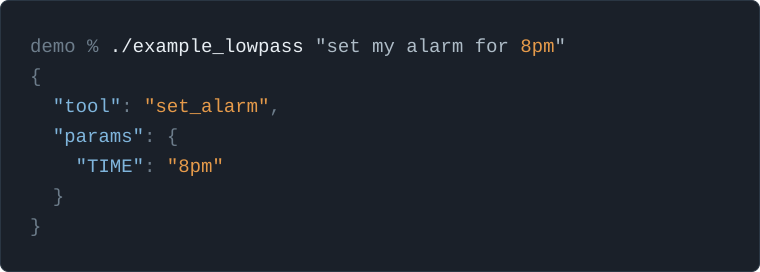

<div align="center">

<picture>
  <source media="(prefers-color-scheme: dark)" srcset="assets/logo-dark.svg">
  
</picture>

**One sentence in, one structured tool call out — locally, with no API and no tokens.**



</div>

It feels wrong to be calling an API for a large vendor model for everything.  Increasingly, I want small 
focused units of "intelligence" (it's not intelligence) to use as building blocks for other applications.  
`lowpass` takes a single text statement and converts it to a tool call.

> A [lowpass filter](https://en.wikipedia.org/wiki/Low-pass_filter) is one of the simplest ideas in
signal processing: it lets low frequencies pass through and rolls off everything above a cutoff.

`lowpass` is designed to run locally, both training and inference, so it can be embedded in
applications with no network access and results in no token use.

## At a glance

|                     |                                                                       |
|:--------------------|:---------------------------------------------------------------------|
| **Inference**       | ~0.9 ms per call, warm and in-process                                 |
| **Cold start**      | ~9.5 ms to load the embedded model and answer the first call          |
| **Model**           | 16.9 MB base encoder + 2.3 KB of trained heads                        |
| **Packaged binary** | 22.7 MB with the weights baked in — no runtime assets to ship         |
| **Training**        | ~1.8 s on CPU for the three-tool example. No GPU                      |
| **Network**         | None. Training and inference are both entirely local                  |

<sub>Measured on an Apple M2 Max using the <code>test_model</code> example — three tools, 75 generated
examples, 40 epochs, which scored 100% held-out intent accuracy and 90.9% per-token slot accuracy.
Your numbers will differ; <code>just train</code> prints accuracy at the end of every run.</sub>

## Why not just call an LLM?

Often you should. But a hosted model is a strange thing to reach for when the question is only *which of
my six tools is this, and what are its arguments* — something small enough to answer on the machine
that asked, in about a millisecond, for nothing.

|                           | `lowpass`                            | Hosted LLM tool call                 |
|:--------------------------|:-------------------------------------|:-------------------------------------|
| Latency                   | ~1 ms, no network                    | Hundreds of ms to seconds            |
| Cost per call             | Zero                                 | Per token                            |
| Works offline             | Yes                                  | No                                   |
| Determinism               | Same input, same output, forever     | Sampling; the model can change under you |
| Data leaves the machine   | Never                                | Every call                           |
| Open-ended language       | Only what you trained it on          | Broad                                |
| Adding a tool             | Add templates, retrain               | Edit a prompt                        |

`lowpass` has a narrow purpose — it is a classifier, not a reasoner.

### When not to use it

- You need multi-turn conversation, or context carried between utterances.
- Your tool set changes at runtime, or your users define their own tools.
- You can't produce training examples — the model only ever knows what it was shown.
- You need real "intelligence" (still not sure it's intelligence :thinking:)

## Prior art

Joint intent classification and slot filling is a long-standing NLU task, and `lowpass` implements
the standard dual-head encoder approach to it
([Chen, Zhuo & Wang, 2019](https://arxiv.org/abs/1902.10909)). I looked at other projects but found
that they did not fit my needs in one way or another.

| Project | Overlap | Status |
|:--|:--|:--|
| [Snips NLU](https://github.com/snipsco/snips-nlu-rs) | On-device intent + slot parsing; Rust inference, Python training | Unmaintained since the team joined Sonos in 2019 |
| [Rasa](https://github.com/RasaHQ/rasa) ([DIET](https://rasa.com/blog/introducing-dual-intent-and-entity-transformer-diet-state-of-the-art-performance-on-a-lightweight-architecture)) | One transformer shared between intent classification and entity extraction | Apache 2.0, maintenance mode; development moved to Rasa Pro |
| [OVOS Padatious](https://github.com/OpenVoiceOS/ovos-padatious-pipeline-plugin) / [Adapt](https://github.com/OpenVoiceOS/ovos-adapt-pipeline-plugin) | Offline intent parsing for voice assistants; Mycroft's successors | Maintained; Padatious documented as legacy and not recommended for new deployments |
| [Picovoice Rhino](https://github.com/Picovoice/rhino) | On-device speech-to-intent | Apache 2.0, but custom models are trained through Picovoice's cloud console and need an account |

How `lowpass` differs:

- Training and inference are both Rust. Snips trained in Python and shipped Rust for inference only;
  Rasa and the reference JointBERT implementations are Python throughout.
- No account, hosted console, or network access at any stage.
- A trained model packages into a single binary with the weights embedded.
- Slot values come back as text spans and nothing more. Snips shipped
  [`snips-nlu-parsers`](https://github.com/snipsco/snips-nlu-parsers) to resolve dates, durations and
  numbers into typed values; `lowpass` has no equivalent, the caller is responsible for types, etc.

The generative alternative — constrained decoding against a local LLM, or a small function-calling
model such as [TinyAgent](https://arxiv.org/abs/2409.00608) — is covered in
[Why not just call an LLM?](#why-not-just-call-an-llm) above.

## How it works

The system operates via a single forward pass through a lightweight Transformer encoder, topped with
two independent, parallel classification heads. 

```text
                          ┌─> [Head 1: Intent] ──> Predicts Tool (e.g., `set_alarm`)
[ User Input String ] ────┤
                          └─> [Head 2: Slots]  ──> Predicts Params (e.g., "7:00 AM" = time)
```

The results of these two predictions are then used to craft a tool call.

See [`FRAMEWORK.md`](FRAMEWORK.md) for the full architecture and training-strategy writeup.

## Repository Layout

```
Cargo.toml                       # workspace: lowpass-lib + generator + resources + trainer
FRAMEWORK.md                     # architecture design doc (dual-head encoder, training strategy)
Plan.md                          # planned work: schema filtering + tool gating, and loose ends
LICENSE-MIT, LICENSE-APACHE      # dual-licensed, see below
assets/                          # logo (light/dark) + the example graphic used above
justfile                         # `just start` / `just generate` / `just train` / `just create` recipes

resources/                       # crate: setup + packaging
  src/download.rs                # pinned, checksum-verified base-checkpoint fetch
  src/name.rs                    # model-name validation (crate names can't contain hyphens)
  src/bin/download_model.rs      # downloads the shared base checkpoint
  src/bin/init_model.rs          # scaffolds a new models/<name>/ with an example tool
  src/bin/create_model.rs        # packages a trained model into a crate
generator/                       # crate: expands tool templates into training examples
lowpass-lib/                     # crate: inference only — types, encoder/head model, decoding
trainer/                         # crate: training pipeline (depends on lowpass-lib)

models/
  bert-tiny/                     # shared pretrained base checkpoint (downloaded by download_model, gitignored)
  <name>/                        # one directory per trained tool-calling model, e.g. `test_model/`
    data/
      tools/                     # templates.json + params.json per tool (tracked)
        <tool>/templates.json
        <tool>/params.json
      training_data.jsonl        # generated by `just generate <name>` (gitignored)
    artifacts/                   # generated by `just train <name>` (gitignored)
      heads.safetensors          # trained intent_head + slot_head weights
      vocab.json                 # intent / slot-tag label vocab used during training
    <name>/                      # packaged crate produced by `just create <name>` (gitignored)
```

Everything under `models/<name>/` besides `data/tools/**` is build output — see
`.gitignore`. Adding a new tool-calling model means creating a new `models/<other_name>/data/tools/`
directory; `models/bert-tiny` (the base encoder) is shared across all of them.

`lowpass-lib` is kept to only what inference needs (the encoder/heads model, the tokenizer, and
decoding predictions into a `ToolCall`) — no training-only code or dependencies, since every
packaged model crate below depends on it. The training pipeline (BIO tagging, encoding examples,
the training loop) lives in `trainer` instead, which depends on `lowpass-lib` for the shared model
and vocab types.

## Setup

You need a working Rust compiler and the [`just`](https://github.com/casey/just) command runner
(although you can run the underlying `cargo` commands individually if you prefer — see the
`justfile`).

## Usage

### Starting a new model

```bash
just start <name>
```

Replace `<name>` with a name of your choosing. A model name becomes a Rust crate and library
name, so it must be ASCII letters, digits and underscores, and must not start with a digit. Hyphens
are rewritten to underscores (`my-tool` becomes `my_tool`) and the corrected name is printed (which
should be used for the commands that follow).

This downloads the shared base checkpoint into `models/bert-tiny`, then scaffolds
`models/<name>/data/tools/` with one example tool (`set_alarm`) so the training pipeline has
something to run on immediately. Both steps are standalone binaries in the `resources` crate
(`download_model` and `init_model`).

The download is pinned to an exact Hugging Face revision and every file is checked against a known
SHA-256, so a local-first framework can't quietly end up running different weights than it was
trained against. Files already present and matching are left alone, which makes `just start` cheap
and safe to re-run.

### Generating training data

This repository contains a simple program for generating data but, of course, you can add your own custom
training examples. In my applications where I use this I continually update the training data and re-train
so it "learns" my speech patterns.  I don't use the generator but it can get you started.

To use the generator edit the scaffolded tool, and/or add more under `models/<name>/data/tools/<tool>/`
(`templates.json` is a list of sentence templates like `"set alarm for {TIME}"`; `params.json` maps
each placeholder to the values it can take).

The number of folders in `models/<name>/data/tools/` is the number of tools available to your eventual
`lowpass` application.

```bash
just generate <name>   # expand templates into BIO-tagged training_data.jsonl
```

This creates a `training_data.jsonl` file that is the input to training.

### Train your model

```bash
just train <name>
```

`just train` freezes the pretrained encoder and only trains the two linear heads (see
`FRAMEWORK.md` §4). It should take a few seconds to a couple of minutes on CPU. It prints held-out intent and
per-token slot accuracy at the end of the run.

This creates the following artifacts in `models/<name>/artifacts/`:
 - `heads.safetensors` — the trained `intent_head` + `slot_head` weights
 - `vocab.json` — the intent and slot-tag label vocab used during training, needed to map the
   heads' output ids back to labels at inference time

### Package your model

Once you're happy with a trained model:

```bash
just create <name>
```

This packages it into a Rust crate at `models/<name>/<name>/`. The base checkpoint and the trained
heads are embedded into the crate's source via `include_bytes!`/`include_str!`, so the built library
and binary need no runtime assets, the model is embedded inside the compiled artifact.

The crate is its own Cargo workspace and builds as-is where it is written, but it is **not**
self-contained: it depends on `lowpass-lib` through the relative path
`../../../lowpass-lib`. Only the weights are vendored into the crate, not the inference code. To use
it from another project, repoint that dependency at a checkout of this repository (or vendor
`lowpass-lib` alongside the crate).

It exposes a single function:

```rust
pub fn lowpass(input: &str) -> anyhow::Result<ToolCall>
```

Loading the embedded assets happens once, on first call. Both loading and inference return errors
rather than panicking, so an embedding application can decide how to handle a failure.

It also builds a CLI binary with the same name as the model:

```bash
cd models/<name>/<name>
cargo run -- "set alarm for 7am"
```

```bash
$ cargo run -- "set alarm for 7am"
{
  "tool": "set_alarm",
  "params": {
    "TIME": "7am"
  }
}
```

## Status :warning:

`lowpass` is under development and the API is not yet stable. I'm using it as a dependency in 
several experimental personal applications so there are no guarantees of stability for now.

Two pieces of the design in [`FRAMEWORK.md`](FRAMEWORK.md), schema filtering and tool gating, 
are documented but not yet built.

## License

Licensed under either of

 * Apache License, Version 2.0 ([LICENSE-APACHE](LICENSE-APACHE) or
   <http://www.apache.org/licenses/LICENSE-2.0>)
 * MIT license ([LICENSE-MIT](LICENSE-MIT) or <http://opensource.org/licenses/MIT>)

at your option.

The base encoder checkpoint that `just start` downloads
([`google/bert_uncased_L-2_H-128_A-2`](https://huggingface.co/google/bert_uncased_L-2_H-128_A-2))
is licensed separately by its authors, under Apache 2.0. A packaged model crate embeds those
weights, so that license travels with anything you build and distribute.

### Contribution

Unless you explicitly state otherwise, any contribution intentionally submitted for inclusion in
the work by you, as defined in the Apache-2.0 license, shall be dual licensed as above, without any
additional terms or conditions.
